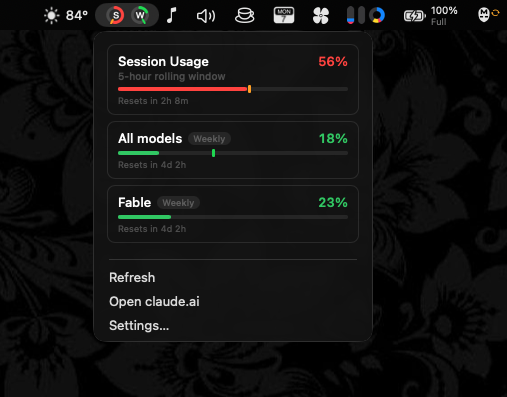

# Claude Usage for Macotron



Session and weekly [claude.ai](https://claude.ai) quota in the
[Macotron](https://github.com/statico/macotron) menu bar. A port of
[Claude-Usage-Tracker](https://github.com/hamed-elfayome/Claude-Usage-Tracker):
same icon styles, same thresholds, same colors, same pace marker.

- Five icon styles: battery, progress bar, ring, percentage, compact dot.
- Green under 70%, orange under 90%, red above. Once 15% of a window has
  passed, the color follows the projected usage instead of the raw number.
- A pace tick sits at the elapsed fraction of the window. Its color says how
  far ahead of it you are: green, teal, yellow, orange, red, purple.
- Click the item for a dashboard with the session, all-models weekly, and
  per-model weekly quotas and their reset times.

## Install

1. Open Macotron. Go to Settings → Plugins → Catalog → Community.
2. Find **Claude Usage**. Press **Add**.
3. Read the source in the review sheet. Press **Add** again.
4. Paste your claude.ai session key into the plugin's **Session key** field.
   Macotron keeps it in the Keychain. See below for where it comes from.

## Where the session key comes from

The key is the `sessionKey` cookie that claude.ai sets in your browser when
you sign in. It starts with `sk-ant-sid` (`sk-ant-sid02-…` at the time of
writing). There is no page on claude.ai that shows it; you read it out of the
browser's cookie store:

- **Safari**: enable the Develop menu (Settings → Advanced → Show features for
  web developers). On claude.ai, choose Develop → Show Web Inspector, open the
  **Storage** tab, expand **Cookies**, pick `claude.ai`, and copy the value of
  `sessionKey`.
- **Chrome, Arc, Edge**: on claude.ai press ⌥⌘I, open the **Application** tab,
  expand **Cookies**, pick `https://claude.ai`, and copy the value of
  `sessionKey`.
- **Firefox**: press ⌥⌘I, open the **Storage** tab, expand **Cookies**.

The cookie lasts until you sign out of claude.ai in that browser, so use a
browser you stay signed in to. If the item shows "Session key rejected", sign
in again and paste the new value.

Claude-Usage-Tracker gets the same cookie by signing you in to claude.ai in an
embedded web view; if you already have it in the Keychain from that app, it is
the same value.

Needs a Macotron build newer than 0.5.1: earlier versions drop the `Cookie` header.

## How it works

The plugin calls the same endpoint the claude.ai web app does:

```
GET https://claude.ai/api/organizations
GET https://claude.ai/api/organizations/<uuid>/usage
```

Every 30 seconds by default.

One login can list several organizations. A Team or Enterprise member
usually has three: a personal org whose usage reply is all nulls, an
API-console org that answers `/usage` with a 403, and the Team org that
holds the quota. The plugin probes each chat-capable org and keeps the first
one that reports a quota, so personal and Team accounts both work. The
chosen id is cached in the plugin's local storage and dropped again when it
stops reporting a quota or the session key is rejected.

## Test

```sh
node test.js
```
